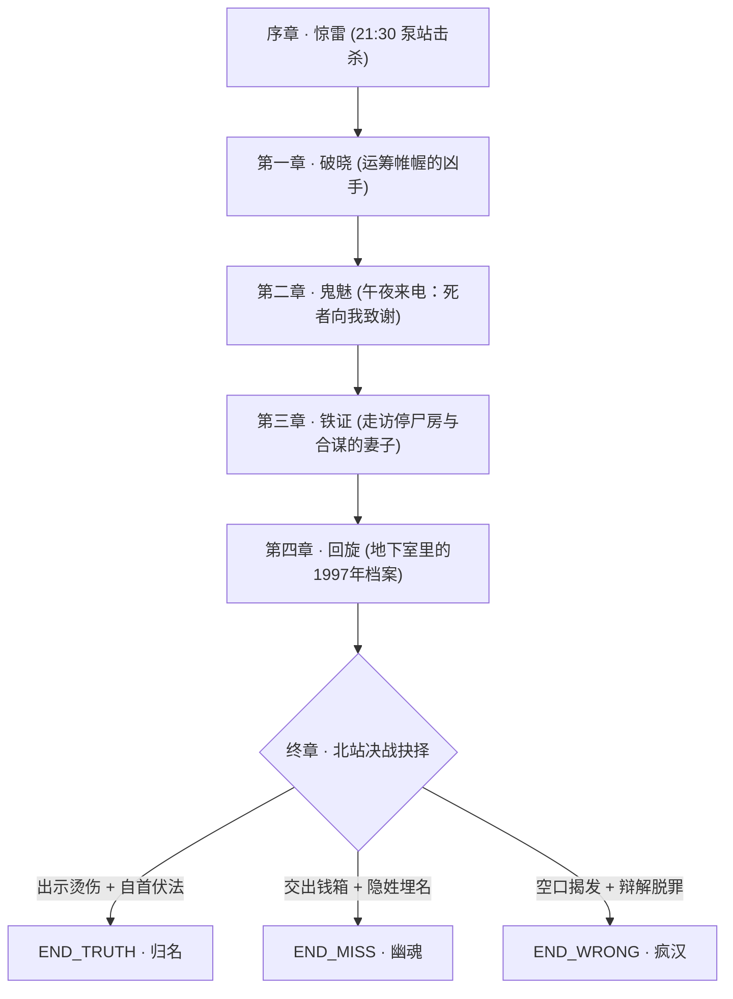

# 提案：g03《借刀》完整设计稿（v0）

> **作品代码**：`g03`  
> **暂定标题**：《借刀》  
> **档案编号**：锦江悬疑宇宙 · 第三号档案 · 二〇〇三  
> **核心钩子**：**你亲手杀了他。第二天，他去派出所报了案。**  
> **技法标签**：倒叙推理（Inverted Mystery）· 借刀杀人 · 身份置换 · 司法与道德双重绝境  

---

## 目录

1. [设计演进与核心思考复盘](#1-设计演进与核心思考复盘)
2. [Phase 0 · 立项审查（三句话与核心边界）](#2-phase-0--立项审查)
3. [Phase 1 · 真相正典化（案情全貌与客观真值）](#3-phase-1--真相正典化)
4. [Phase 2 · 线索系统与释放矩阵](#4-phase-2--线索系统与释放矩阵)
5. [Phase 3 · 游戏结构与三重高潮设计](#5-phase-3--游戏结构与三重高潮设计)
6. [Phase 4 · 结局树与多结局判定](#6-phase-4--结局树与多结局判定)
7. [Phase 5 · 文字舞台演出台账与感官设计](#7-phase-5--文字舞台演出台账与感官设计)

---

## 1. 设计演进与核心思考复盘

### 1.1 初始构想的死穴与批判
在早期构想《留真》（暗房冲印）中，我们尝试了「玩家即凶手」的倒叙模式。但在立项复盘中暴露出致命缺陷：
* **致命缺陷**：玩家从第 1 分钟就百分之百知道「我是凶手、我砸死了人」，结局翻开的所谓真相仅是「死者在暗房清醒了四十分钟冲洗照片」。
* **体感落差**：这只是**「法医死因微调 + 散文抒情补叙」**，对于悬疑玩家来说完全是自我感动。底牌在第 0 秒出尽，后面缺乏任何智力层面的核爆反转（Aha Moment）。

### 1.2 倒叙反转的黄金法则：打碎玩家的「认知特权」
倒叙推理的本质是信息先验。要让读者在终局产生真正的头皮发麻与顿悟，绝不能停留在抓破绽，而必须击穿第 1 幕玩家坚信不疑的核心基石：
* **你以为你在行凶，其实你只是一柄被借去杀人的凶器。**
* **你以为你杀了恶魔，其实你亲手屠戮了无辜者。**
* **你精心打造的完美不在场证明，最终变成了囚禁你灵魂的无期铁笼。**

### 1.3 两个关键技术漏洞的严密论证与闭环

#### Bug 1：替身如何主动且合理地走向死地？
* **错误解法**：下安眠药。被下药的人无法在深夜冒雨徒步走向偏僻泵站，否则现场必留第三人搬运痕迹。
* **终极闭环（主动且热忱的替身）**：
  1. 替身**刘亮**（22岁，农村进城打工青年，幼年声带烫伤哑言，极度缺钱救母）。
  2. 老韩提前支付两千元巨额定金，谎称有一名胆小赖账的债务人要在深夜泵站交割现金与账本。
  3. 老韩指使刘亮：穿上老韩显眼的羊皮大衣、戴呢帽、拿手杖、压低帽檐伪装气势；
  4. **老韩严令刘亮绝对不许开口说话**（防止川北口音露底），只许坐在阴影里拿出金火机连打三下火（「咔嗒、咔嗒、咔嗒」）。
  5. 刘亮满怀感激与希望，完全清醒、主动依令赴约，在打响火机等待交钱的瞬间，被埋伏在横梁上的主角击杀。

#### Bug 2：2003 年法医与警方为何会百分之百认定尸体是老韩？
* **错误解法**：仅靠面部毁容。现代刑侦常识会立即通过指纹、血型、DNA 识破。
* **终极闭环（时代特征与法医学四重定案锁）**：
  1. **DNA 盲区（2003 年历史真实）**：中国尚未建立全国公民 DNA 数据库；单次 STR-DNA 检测需耗资两千元且耗时数周；司法实践中，只要随身证件完整、体貌相符且**直系亲属到场指认无异议**，绝不启动高额 DNA 程序。
  2. **家属合谋认尸**：老韩妻子周翠兰是同谋。老韩涉案千万非法集资爆仓，唯有「被杀身亡」能让债务随自然人死亡终止，同时激活保额高达 300 万元的「人身意外险凶杀双倍赔付条款」。妻子在停尸房痛哭签字认领，亲手封死了尸源调查的大门。
  3. **逆向指纹陷阱（高智商犯罪核心）**：老韩表面无犯罪前科，一代身份证无芯片无指纹，警方无指纹底卡。警方比对指纹的常规做法是赴老韩私人办公室提取其桌面、茶杯的潜伏指纹。而老韩在案发前半个月特意将刘亮调入办公室打杂，自己全程戴手套，指使刘亮擦拭茶杯、使用键盘。**警方在办公室采得的对照指纹，自始至终就是刘亮的指纹！**
  4. **随身物理铁证**：一代身份证、手表、刻名打火机，尤其是死者口袋里的钥匙串——经民警现场查验，**能精准开锁老韩家的防盗门和别克汽车**。血型同为 B 型，身高同为 172cm。四重铁证，定性如山。

---

## 2. Phase 0 · 立项审查

### 2.1 三句话定标（P0 完成门）
1. **真相是什么**：非法集资濒临暴雷的典当老板韩荣，为了侵吞千万资金并金蝉脱壳，利用哑巴替身刘亮伪装成自己，诱导并借用深怀仇怨的下岗手艺人宋明之手将其砸死，再由妻子伪证认尸，意图以此假死永久洗白。
2. **玩家以什么身份逼近它**：玩家即凶手宋明。在完成自以为正义的完美谋杀后，震惊地发现「死者」活生生站在城市暗处，玩家必须在「保护自己完美脱罪」与「查明死者真实身份」的撕裂深渊中展开调查。
3. **结局分几层**：
   * **真结局（自毁式反杀）**：宋明查明被杀少年刘亮身份，认领六年前导致其家破人亡的原罪，自毁完美不在场证明，在火车站当众自首并血刺老韩，用死罪为无名少年换回真实姓名。
   * **擦肩结局（魔鬼的契约）**：宋明选择沉默自保，接受老韩的封口资助远走他乡，余生在无辜少年的冤魂噩梦中日夜煎熬。
   * **歧途结局（顶罪的弃子）**：宋明试图直接检举老韩假死，但缺乏刘亮身源硬证且无法推翻警方物证，反被警方认定为蓄意虐杀无辜少年后的精神妄想，被判处死刑立即执行。

### 2.2 死亡名单（不可触碰的红线）
* **真凶与诡计**：韩荣借宋明之手杀死刘亮以金蝉脱壳的结构不可改动。
* **时代与背景**：2003 年冬，非典余波，火车北站，无超自然，不可加入现代智能刑侦手段（如人脸识别、全网DNA检索）。
* **宇宙客串约束**：何峥（g02）担任现场查验与提审刑警，潇文（g01）提供半夜面不在场证明，均严格遵循人物设定，不作为第一破案视角。

---

## 3. Phase 1 · 真相正典化

### 3.1 真实时间轴（2003 年 11 月）

| 时间 | 事件 ID | 真实事实 | 披露阶段 |
|---|---|---|---|
| **1997-09** | `ev-1997-downsize` | 国企改制，宋明亲手将老工人刘建国（刘亮之父）划入下岗名单，导致刘家破产。 | ch4 调查得知 |
| **2003-05** | `ev-2003-insurance` | 韩荣为自己购买 300 万巨额意外险，指定受益人为妻子周翠兰，含凶杀双倍赔偿。 | ch3 文件得知 |
| **2003-10** | `ev-2003-ponzi-burst` | 韩荣融泰投资 1200 万非法集资资金链断裂，经侦立案前夕，韩荣启动脱身计划。 | ch3 账册得知 |
| **2003-11-01** | `ev-2003-fingerprint` | 韩荣以提拔为由，让刘亮进入独立办公室擦茶杯、整理文件，布置潜伏指纹对照样。 | 终章 揭晓 |
| **2003-11-12 20:30** | `ev-2003-hiring-proxy` | 韩荣在车库付刘亮 2000 元定金，赠大衣与手杖，严令其噤声、打火机三响赴约。 | 终章 还原 |
| **2003-11-12 21:30** | `ev-2003-murder-night` | 东郊废弃泵站，宋明埋伏横梁，以铸铁滑轮砸死赴约的「老韩」，搜走包内纸袋。 | **序章 亲历** |
| **2003-11-12 22:15** | `ev-2003-alibi-noodles` | 宋明赶到玉林北巷「半夜面」，在望哥店里吃面，并经社区非典体温筛查登记。 | ch1 回溯 |
| **2003-11-13 08:00** | `ev-2003-body-found` | 泵站涵洞发现浮尸，头面粉碎骨折；民警搜得老韩身份证与家门钥匙。 | ch1 爆发 |
| **2003-11-13 14:00** | `ev-2003-false-id` | 周翠兰在法医中心认尸痛哭；警方比对老韩办公室茶杯指纹，完全一致。 | ch2 通报 |
| **2003-11-13 23:00** | `ev-2003-night-call` | 宋明家中座机响起，老韩操着熟悉的沙哑咳嗽声向宋明致谢并提出契约。 | ch2 钩子 |
| **2003-11-15 21:00** | `ev-2003-station-showdown` | 成都火车北站广场，宋明赴约交割，终局决战。 | 终章 决战 |

### 3.2 人物全档

```yaml
characters:
  - id: songming
    name: 宋明
    birth_year: 1962
    bio_public: 原东郊内燃机厂工会干事、高级机修钳工，下岗后在致民路经营「明成五金机修铺」。性格谨小慎微，极其自负于自己的手艺和清白名声。
    bio_secret:
      - 1997年为了保住亲属名额，暗箱操作将刘建国排挤下岗；
      - 2002年借高利贷给女儿治病，被韩荣扣押房产证并逼迫充当走私零配件中介；
      - 2003年11月12日蓄意谋杀「韩荣」。
    voice_hz: 185
    stage: { side: "left", theme: "cyan" }

  - id: hanrong
    name: 韩荣（老韩）
    birth_year: 1955
    bio_public: 融泰典当投资公司老总，常年穿定制羊皮大衣，手执黄铜手杖，烟瘾极大。
    bio_secret:
      - 非法集资千万即将暴雷，策划借宋明之手杀死刘亮换取假死身份；
      - 手握宋明杀人全套影像记录，意图迫使宋明自首顶罪以彻底封闭命案。
    voice_hz: 142
    stage: { side: "right", theme: "blood" }

  - id: liuliang
    name: 刘亮（死者）
    birth_year: 1981
    death_year: 2003
    bio_public: 典当行洗车打杂工，川北南充农村人，声带受损致哑。
    bio_secret:
      - 其父为刘建国；
      - 为给母亲挣透析费，欣然接下穿戴老韩行头取款的秘密任务，毫无防备地赴死。
    stage: { side: "center", theme: "ash" }

  - id: zhouchuilan
    name: 周翠兰
    birth_year: 1958
    bio_public: 韩荣结发妻子，看似怯懦老实。
    bio_secret:
      - 假死骗保共同谋划者；
      - 亲手在停尸房指认刘亮为丈夫。
    voice_hz: 245
    stage: { side: "right", theme: "sepia" }

  - id: hezheng
    name: 何峥（客串刑警）
    birth_year: 1972
    universe_role: g02民警，现调入刑警支队。重现场物证，不相信无证据的翻供。
    voice_hz: 168
    stage: { side: "right", theme: "slate" }

  - id: xiaowen
    name: 潇文（望哥 / 原型客串）
    birth_year: 1970
    universe_role: 玉林「半夜面」掌柜。见证当晚宋明吃面与体温检测，真实无伪的不在场证人。
    voice_hz: 204
    stage: { side: "left", theme: "amber" }
```

---

## 4. Phase 2 · 线索系统与释放矩阵

### 4.1 核心解题链（Logic Chain）
```
[血污献血证] + [刘亮合租屋档案] → 锁定死者真实姓名与身世
  ↓
[办公室指纹提取记录] + [刘亮值班表] → 识破「逆向指纹替代诡计」
  ↓
[保险单双倍赔偿条款] + [周翠兰账户] → 锁定「夫妻合谋假死骗保」动机
  ↓
[韩荣真实烫伤疤痕档案] + [假身份证火车票] → 终局指认活体韩荣
```

### 4.2 核心线索卡（部分示范）

```yaml
- id: clue-blood-card
  object: 染血的四川省无偿献血证
  obtain: 序章行凶搜身从死者内兜摸出，ch1 在灯下查看
  surface: 死者私人物品，上面写着「刘亮，男，22岁，血型B」
  truth: 证明死者根本不是50岁的老韩，而是年轻无辜者 → 触发认知崩塌
  question: 身份谜（死在铁轮下的究竟是谁）

- id: clue-teacup-fingerprint
  object: 刑侦勘验通报（复印件）
  obtain: ch3 从何峥警官桌面或经侦线索中瞥见
  surface: 现场尸体指纹与老韩办公室高档紫砂杯指纹 100% 吻合
  truth: 老韩提前半月安排刘亮使用该杯，警方对照样已被污染
  question: 手法谜（法医物证为何被完美误导）

- id: clue-downsize-list
  object: 1997年内燃机厂下岗分流安置审批表
  obtain: ch4 搜查刘亮床板夹层
  surface: 刘建国名字被红笔划掉，审批签字人「工会干事：宋明」
  truth: 揭露主角原罪，确立因果闭环与宿命悲剧
  question: 利害与道德谜（刘亮与宋明的深层因果）

- id: clue-arc-scar
  object: 1983年劳模工伤治疗记录纸
  obtain: ch4 从老机修厂档案室查得
  surface: 韩荣年轻时电焊飞溅，右小臂内侧留有永久性电弧焊三度烫伤
  truth: 火车站决战时撕开老韩伪装膏药的终极物证
  question: 手法谜（如何物理锚定活着的假死者）
```

### 4.3 释放矩阵

| 核心知识点 \ 章节 | 序章（行凶） | ch1（破晓） | ch2（午夜来电） | ch3（深渊对峙） | ch4（因果档案） | 终章（决战） |
|---|---|---|---|---|---|---|
| 宋明谋杀老韩事实 | ✓ 亲历 | ✓ | ✓ | ✓ | ✓ | ✓ |
| 宋明不在场证明成立 | ✗ | ✓ 确立 | ✓ | ✓ | ✓ | 破除 |
| 死者并非韩荣（刘亮） | ✗ | ◇ (见献血卡) | ✓ 确认 | ✓ | ✓ | ✓ |
| 韩荣存活且主动控局 | ✗ | ✗ | ✓ (电话现身) | ✓ | ✓ | ✓ |
| 指纹替换手法 | ✗ | ✗ | ✗ | ◇ (疑点) | ✓ 解密 | ✓ |
| 1997 下岗因果原罪 | ✗ | ✗ | ✗ | ✗ | ✓ 揭晓 | ✓ 爆发 |
| 韩荣手臂烫伤物理铁证 | ✗ | ✗ | ✗ | ✗ | ✓ 获得 | ✓ 验明 |

---

## 5. Phase 3 · 游戏结构与三重高潮设计



### 章节节奏曲线
* **序章 · 惊雷**：高冷机械感。以第一视角执行缜密的行凶计划，从落锁、断电、吊车横梁、滑轮下坠到搜包，营造极度真实的犯罪参与感。
* **第一章 · 破晓**：智商压制感。面对派出所与非典排查，宋明依靠半夜面的体温单与邻里证词，从容过关。然而从死者身上摸出的那张血染献血证，开始渗出刺骨寒意。
* **第二章 · 鬼魅**：惊悚崩塌。座机响起，死者在电话那头咳嗽、说话。玩家从自诩聪明的猎人，瞬间沦为赤裸的猎物。
* **第三章 · 铁证**：智力破谜。调查为何法医指纹无误、家属为何快速认尸。识破老韩的骗保与金蝉脱壳之局。
* **第四章 · 回旋**：灵魂暴击。查清刘亮身世，翻出六年前自己亲手签署的下岗名单。正义光环粉碎，主角陷入巨大的道德自戗与存在危机。
* **终章 · 决战**：北站广场大雾。在数十名巡警与上千旅客面前，面对老韩递来的魔鬼契约，做出决断。

---

## 6. Phase 4 · 结局树与多结局判定

### 6.1 真结局：`END_TRUTH`【归名】
* **判定条件**：
  * 持有 `clue-blood-card`（刘亮献血证）
  * 持有 `clue-arc-scar`（老韩烫伤档案）
  * 做出选择：**把箱子扔进警务室，当众刺伤老韩并承认谋杀刘亮**
* **落幕呈现**：
  宋明伏法。法医重新检验，通过烫伤、深层骨骼及假身份证锁定韩荣真身；周翠兰骗保案告破。
  数月后，成都市公墓，原「韩荣之墓」被执法撤换，立起一方朴素石碑：**「刘亮之墓 · 一九八一—二〇〇三 · 川北南充人」**。宋明在狱中收到判决书，平静受刑。这是符合宇宙宪法的 3 度仰角：罪孽被清算，但微小的体面被还给了死者。

### 6.2 擦肩结局：`END_MISS`【幽魂】
* **判定条件**：
  * 选择：**将箱子交给老韩，换取封口费与远走他乡的假身份**
* **落幕呈现**：
  老韩在汽笛声中顺利南下，老韩之死成为悬案结案。宋明带着五万块钱搬到了攀枝花，修了一辈子的表和自行车。他再也没犯过法，但此生每一个雨夜，他都会听见那三声金属火机的「咔嗒、咔嗒、咔嗒」。他活着，但灵魂早已与刘亮一同埋进了东郊臭水沟。

### 6.3 歧途结局：`END_WRONG`【疯汉】
* **判定条件**：
  * 未获取关键物理证据 `clue-arc-scar`，直接在车站或警局指控老韩没死，并试图撇清自己的杀人责任。
* **落幕呈现**：
  老韩早已伪装出境。警方在宋明铺子里搜出了沾有刘亮脑组织的铸铁滑轮。在绝对的法医物证与办公室指纹面前，宋明的供词被视为恶性谋杀贫困青年后的精神失常与脱罪狡辩。宋明被判处死刑立即执行，至死背负着杀害残疾少年的恶魔罪名，而真凶在海边安度晚年。

---

## 7. Phase 5 · 文字舞台演出台账与感官设计

### 7.1 核心声音设计（代码合成音轨）
1. **火机三响（Death Trigger）**：黄铜外壳清脆弹开声，紧接两声火石摩擦声（`click-flick-clink`），作为贯穿全剧的恐怖图腾。
2. **滑轮落坠（The Strike）**：铸铁在钢梁滑动的尖锐啸叫，戛然而止于沉闷肉体撞击音（白噪声低通冲击）。
3. **电话盲音与咳嗽声（Phantom Voice）**：老韩标志性的沙哑清嗓音（通过合成低频锯齿波滤波模拟）。

### 7.2 视觉与氛围签名
* **地点**：
  * `dongjiao-pumping-station`（东郊泵站）：工业残渣、生锈铁梁、暴雨、暗绿冷调。
  * `north-station-square`（火车北站）：大雾、深冬、测温枪的红外微光、绿色帆布大衣人流。
* **标志性实体卡**：
  * 红色印泥斑驳的「国营下岗审批单」
  * 沾血塑料套内的「无偿献血证」
  * 冒着火星的假发票与旧防盗门黄铜钥匙串

---

### 8. 立项准备就绪确认
本设计稿已完全对齐 `docs/指南-悬疑小说拆解-v1.md` 的 P0–P3 要求，所有科学常识、时代局限、法医实务均已闭环，且无任何超自然元素。待用户确认后，即可执行 `node tools/new-game.mjs g03-jiedao 借刀` 建立工程骨架。
