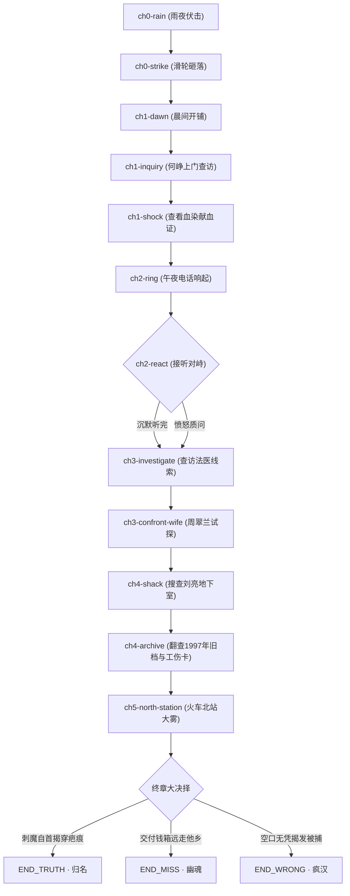

# g03《借刀》游戏结构与拓扑设计（Structure）

## 1. 章节拓扑与场景列表

## 2. 门禁规则（Gates）
* 进入 `END_TRUTH` 必须同时拥有 flags：
  * `fact.ev-g03-murder`（泵站命案事实）
  * `has_blood_card`（持有刘亮献血证）
  * `has_scar_archive`（持有电弧焊烫伤档案）
  * 做出抉择：`choice_confess_stab`（当众刺魔自首）
* 若未持 `has_scar_archive` 却试图指控，落入 `END_WRONG`；
* 若选择妥协交包，落入 `END_MISS`。
